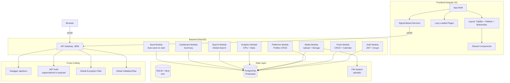
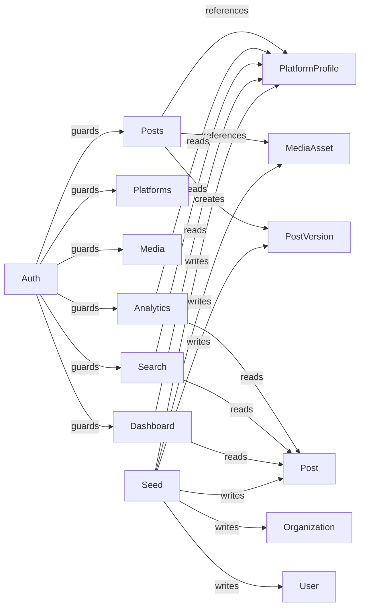

# Architecture Overview

## System Diagram



## High-Level Architecture

This is a **two-tier web application** (SPA + REST API) with a monorepo structure:

```
social-scheduler/
├── apps/
│   ├── api/          # NestJS backend (port 3000)
│   └── web/          # Angular 22 frontend (port 4200)
├── docs/             # Documentation
├── package.json      # Root orchestration (concurrently)
└── .env.example      # Environment template
```

### Frontend (Angular 22)

The frontend is a **standalone, zoneless, signal-first** Angular application. It uses:
- **Standalone components** — no NgModules, every component declares its own imports
- **Angular Signals** for all state management — no NgRx, no RxJS subjects for state
- **Zoneless change detection** (`provideZonelessChangeDetection()`) — change detection fires only when signals change
- **Tailwind CSS v4** with a full `@theme` design token system including platform colors
- **Dark mode** via CSS class toggling, persisted in localStorage
- **Lazy-loaded routes** for all 7 page components

#### State Management Pattern

All state lives in **injectable services** using Angular signals. The pattern is consistent:

```typescript
@Injectable({ providedIn: 'root' })
class SomeService {
  // State signals
  readonly data = signal<T[]>([]);
  readonly loading = signal(false);
  readonly error = signal<string | null>(null);

  // Computed derived state
  readonly isEmpty = computed(() => this.data().length === 0);

  // Actions (methods)
  loadData(): void {
    this.loading.set(true);
    this.http.get<T[]>('/api/some-endpoint').subscribe({
      next: (data) => { this.data.set(data); this.loading.set(false); },
      error: (err) => { this.error.set(err.message); this.loading.set(false); },
    });
  }
}
```

Components inject services and bind to signals directly in templates. The `effect()` function is used sparingly, primarily to react to signal changes and trigger data loading or side effects.

### Backend (NestJS)

The backend follows standard NestJS module architecture:

- **8 feature modules** (Auth, Posts, Platforms, Media, Analytics, Search, Dashboard, Seed)
- **Global prefix**: `/api`
- **Global validation**: `ValidationPipe` with `whitelist: true` and `transform: true`
- **Global exception filter**: Catches all exceptions and returns consistent JSON error format
- **JWT authentication** via Passport strategy, with `organizationId` embedded in the JWT payload
- **TypeORM** with the `sql.js` driver (SQLite via JavaScript) for development

#### JWT Payload Structure

```json
{
  "sub": 1,
  "email": "ana@techcorp.com",
  "organizationId": 1,
  "role": "admin",
  "iat": 1688000000,
  "exp": 1688604800
}
```

Every controller method that needs tenant scoping extracts `req.user.organizationId` and passes it to service methods, which use it in every query's `where` clause.

#### Seed-on-Start

The `SeedModule` contains a `SeedService` that implements `OnModuleInit`. On every application startup, it:
1. Checks if any organizations exist in the database
2. If the DB is empty, seeds 1 org (TechCorp), 1 admin user, 4 platform profiles, 3 media assets, 8 posts with version history
3. If data exists, skips seeding

This makes the dev experience seamless — no separate seed command needed.

## Data Flow: Creating a Post

```
User fills form → PostFormComponent collects signal values
                → PostService.createPost() → HTTP POST /api/posts
                → PostsController.create() → PostsService.create()
                → TypeORM: INSERT into posts
                → TypeORM: INSERT into post_versions (v1)
                → Response: post with relations
                → PostService.posts.update() (prepend to list)
                → UI reactively updates
```

## Data Flow: Calendar Drag-and-Drop Reschedule

```
User drags post card to new date → CalendarPageComponent
                                 → PostService: PATCH /api/posts/:id/reschedule
                                 → PostsController.reschedule()
                                 → PostsService.reschedule()
                                 → Updates post.scheduledAt
                                 → If status was 'draft', promotes to 'scheduled'
                                 → Response: updated post
                                 → Calendar reactively re-renders
```

## Module Dependency Graph



## CORS & Static Files

- **CORS**: Wide-open (`origin: '*'`) for development — tighten in production
- **Static files**: `uploads/` directory is served at the `/uploads` URL path for media assets
- **Swagger**: Available at `/api/docs` after server start

## Key Design Decisions

1. **Signal-first frontend state** — chosen over NgRx for simplicity and bundle size; signals are sufficient for this scale of application
2. **Zoneless change detection** — enables better performance, smaller bundles, and aligns with Angular's future direction
3. **Multi-tenant via JWT** — `organizationId` in token payload avoids the complexity of separate databases per tenant while still scoping all queries
4. **sql.js for development** — zero-config SQLite that works in pure JavaScript, enabling instant dev setup without installing database servers
5. **PostgreSQL-ready schema** — TypeORM entities use standard column types that map cleanly to PostgreSQL, and the connection config can be swapped with a single config change
6. **Auto-seed on startup** — eliminates manual seed commands, making the project immediately runnable after `npm install && npm run dev`
